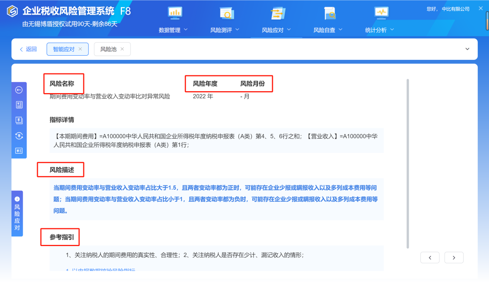

详情和对策制定可以点的动就行，其他不要紧。
两个风险名称分别为：委托物流配送业务风险、委托付款进项转出风险
详情1：（详情里就纯复制文字就行了 相当于是一个案例）

### 30万元委托物流配送业务

#### （一）业务背景与交易链条
中比新能源公司向一家小型新能源汽车组装厂销售价值 30 万元的锂电池组，为提升配送效率，委托第三方专业物流企业负责货物运输。该业务涉及三方主体，分别是中比新能源（销售方）、小型汽车组装厂（购买方）以及第三方物流企业（配送方）。

#### （二）四流具体走向
合同流：小型汽车组装厂为甲方，中比新能源公司为乙方，资金流向明确，体现了买卖双方的直接经济往来。
资金流：购买方小型汽车组装厂通过银行转账的方式，将30万元货款直接支付给销售方中比新能源公司，资金流向明确，体现了买卖双方的直接经济往来。
发票流：中比新能源公司作为销售方，向购买方小型汽车组装厂开具含税金额为 30 万元的增值税专用发票，发票内容与实际销售的锂电池组一致，税率为13%，对应的税额为3.45 万元，这是计算可抵扣税额的重要依据。
物流流：中比新能源公司先将锂电池组交付给第三方物流企业，第三方物流企业凭借《货物运输单》，将货物配送至购买方小型汽车组装厂的仓库。在此过程中，物流环节由第三方物流企业完成，与资金流和发票流的路径不同，形成了四流不一致的情况。

#### （三）是否可以抵扣进项税额
若可抵扣进项税额： 30万÷(1 + 13%)×13% = 3.45万元。

对策制定1：（最好也参考这个系统的格式）

风险名称                         风险年度         风险月份
委托物流配送业务风险                      2024                 4
风险描述
当物流流与合同流、资金流、发票流不一致时，提示可能存在虚构交易或虚开发票的行为。

参考指引
1、税务处理依据：根据《国家税务总局关于加强增值税征收管理若干问题的通知》（国税发〔1995〕192 号）第一条第三款 “三流一致” 原则，虽然该业务的物流由第三方承接，导致三流走向（加合同流）不一致，但只要能证明物流委托的真实性，允许进行增值税进项税额的抵扣。
对策制定：
1、补充《资金代收说明》：由购买方小型汽车组装厂出具书面文件，在说明中明确 “货款30万元直接支付至中比新能源公司账户，物流由第三方企业独立承接”，以此证明资金流向的合理性以及物流委托的真实性。
2、附《货物运输单》：第三方物流企业开具的运输单据需详细标注货物名称为 “锂电池组”、数量以及起运地（中比新能源公司仓库）至目的地（小型汽车组装厂工厂）的具体信息，确保物流路径清晰可查。

